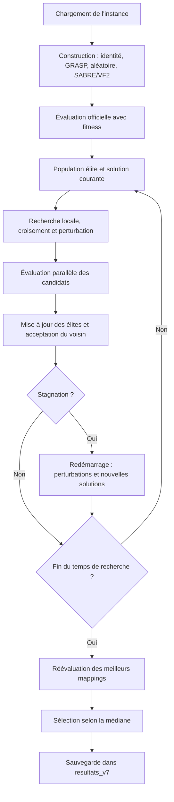

# V7 — Métaheuristique hybride pour le Qubit Allocation Problem

## 1. Objectif du projet

Le but est de placer les `n` qubits logiques d'un circuit sur les `m` qubits physiques d'une machine quantique, de manière à minimiser la profondeur du circuit après transpilation. Une solution est un mapping, c'est-à-dire une liste de `n` positions physiques distinctes parmi `0, …, m-1`.

Par exemple, `[2, 0, 4]` signifie que les qubits logiques 0, 1 et 2 sont placés respectivement sur les qubits physiques 2, 0 et 4. L'ordre est donc important. L'espace de recherche contient `m! / (m-n)!` solutions, ce qui rend une recherche exhaustive impraticable dans le budget de cinq minutes.

Le fichier `StudentCodeV7.py` propose les mappings et le fichier `source.py`, fourni par le professeur et laissé inchangé, les évalue avec Qiskit 1.2.4. La fonction officielle `fitness` renvoie la profondeur du circuit transpilé : plus elle est faible, mieux c'est.

## 2. Fonctionnement général de la V7

La V7 est une **métaheuristique hybride à dominante mémétique** : elle combine une construction inspirée de GRASP, une population élite, une recherche locale, des croisements et des mécanismes de diversification inspirés du recuit simulé et des voisinages variables.

Elle fonctionne en trois phases : construction, optimisation et validation.



### Phase 1 — Construire de bonnes solutions initiales

Au lieu de partir uniquement de solutions aléatoires, on utilise plusieurs sources de mappings :

- **GRASP** : placer progressivement les qubits qui interagissent ensemble à proximité les uns des autres. Le choix est effectué aléatoirement parmi les meilleures possibilités pour obtenir des solutions variées. Une courte descente sur le guide de graphe améliore ensuite le mapping.
- **SABRE et VF2** : utiliser les méthodes de placement de Qiskit pour proposer d'autres mappings. SABRE tient compte du routage, tandis que VF2 cherche une correspondance entre le graphe d'interactions et celui de la machine.
- **Aléatoire et identité** : diversifier les points de départ et disposer d'une solution simple de référence.

Toutes ces propositions sont évaluées par la même fonction `fitness` officielle.

### Phase 2 — Améliorer et diversifier les solutions

Le programme conserve jusqu'à 12 solutions élites de bonne qualité et suffisamment différentes. La différence entre deux mappings est mesurée par le nombre de positions qui diffèrent (distance de Hamming).

À chaque tour, il génère plusieurs candidats, puis évalue ceux qui n'ont pas encore été visités. Avec quatre processus, un lot comporte jusqu'à huit candidats. Plusieurs mécanismes interviennent :

| Mécanisme | Principe dans la V7 |
|---|---|
| Recherche locale | Échanger deux positions ou utiliser un qubit physique libre. |
| Croisement (path relinking) | Rapprocher partiellement un bon mapping d'un autre, sans doublon. |
| Recuit simulé | Accepter parfois un voisin moins bon pour sortir d'un minimum local. |
| Perturbations (VNS / ILS) | Effectuer plusieurs échanges pour explorer des solutions plus éloignées. |
| Redémarrage | Après cinq tours sans amélioration de la solution courante, produire des mappings perturbés, GRASP ou aléatoires. |
| Mémoire | Éviter les évaluations répétées pendant l'exploration et conserver les coûts déjà observés. |

Tous les huit tours, la recherche revient vers le meilleur mapping classé à ce moment-là. Cela permet de continuer à exploiter les bonnes solutions sans abandonner les autres régions explorées.

**Exemple de voisinage :**

```text
Mapping courant : [1, 5, 3, 8, 2, 6]
                       ↕        ↕
Échange         : [1, 2, 3, 8, 5, 6]
```

Si la position 0 est libre, on peut aussi remplacer une position occupée par 0. Ces mouvements préservent toujours la validité du mapping.

#### Un guide de graphe pour accélérer la recherche

Le programme calcule les plus courtes distances entre les qubits physiques et les interactions entre les qubits logiques. Il utilise alors un coût auxiliaire :

$$
H(\pi)=\sum_{i<j} w_{ij}\max(0,d(\pi_i,\pi_j)-1)
$$

- $\pi_i$ : position physique du qubit logique $i$ ;
- $w_{ij}$ : importance des interactions entre les qubits $i$ et $j$ ;
- $d$ : distance dans le graphe physique.

Une interaction entre deux qubits voisins n'est pas pénalisée. Trois pondérations temporelles permettent de favoriser plus ou moins les interactions du début du circuit. Ce calcul rapide aide à choisir les échanges prometteurs, mais des échanges aléatoires restent possibles. **Le guide ne remplace jamais `fitness`** : la profondeur réelle dépend aussi du routage et de l'ordre des portes.

### Phase 3 — Valider les meilleures solutions

Qiskit comporte une part d'aléatoire : `source.py` ne fixe pas `seed_transpiler`. Un même mapping peut donc donner plusieurs profondeurs différentes, même si la graine de notre métaheuristique est fixée.

Pour limiter l'influence d'un bon coût obtenu par chance, la V7 réévalue les huit meilleurs mappings (avec quatre processus), puis les trois finalistes jusqu'à neuf observations au total, si le temps le permet. La sélection finale compare les candidats de la liste initiale ayant au moins trois observations et privilégie la médiane la plus faible. En cas d'égalité, davantage d'observations puis un meilleur minimum départagent les candidats. Si aucun n'est suffisamment réévalué, le code utilise les observations disponibles.

Exemple réel (instance 3) : le mapping final donne les coûts suivants :

```text
113, 119, 115, 117, 119, 115, 115, 119, 113
Médiane : 115
```

Le minimum brut de toute la recherche était 106, mais cela ne signifie pas que le mapping exporté donne 106. La médiane favorise une bonne performance typique ; elle ne garantit pas un coût constant. Ce critère est notre choix provisoire, car le protocole de vérification du professeur n'est pas précisé.

## 3. Liens avec les principes du cours

Le principe central est le compromis entre **intensification** (améliorer les bonnes solutions) et **diversification** (découvrir de nouvelles régions de l'espace de recherche).

| Notion du cours | Application dans notre algorithme |
|---|---|
| Recherche locale et voisinages | Échanges et réaffectations guidés par les distances. |
| GRASP | Construction gloutonne randomisée, suivie d'une descente. La V7 tire parmi les meilleurs candidats plutôt que d'utiliser exactement le paramètre alpha du cours. |
| Recuit simulé | Une dégradation de coût $\Delta>0$ peut être acceptée avec une probabilité $\exp(-\Delta/T)$. La température diminue avec le temps de recherche. |
| VNS / ILS | Des perturbations de tailles différentes et des redémarrages permettent de changer de région. Il s'agit d'une inspiration VNS, pas de son algorithme classique exact. |
| Algorithme évolutionnaire / mémétique | Conservation d'une population élite, recombinaison de bonnes solutions, recherche locale et maintien de la diversité. |
| Hybridation | Les méthodes de construction alimentent la recherche ; la recherche locale et le recuit sont intégrés à la stratégie mémétique. |

La mémoire des solutions rappelle l'idée de mémoire du cours sur la recherche taboue, mais **la V7 n'est pas une recherche taboue classique** : elle ne possède pas de liste taboue temporaire de mouvements.

## 4. Implémentation et exécution

| Élément du code | Rôle |
|---|---|
| `Guide` | Construit les mappings et génère les voisins, perturbations et croisements. |
| `Search` | Gère la mémoire, les élites, l'optimisation et la validation finale. |
| `tache` / `batch` | Exécutent les évaluations et les amorces Qiskit en parallèle. |
| `main` | Lance les processus, gère le chronomètre et arrête les workers. |

Paramètres par défaut : 300 secondes maximum pour l'optimisation, quatre processus si disponibles, graine de recherche 42, mode `hybrid`. Une réserve de temps est ajustée pour les réévaluations finales et une marge de trois secondes est prévue pour arrêter les processus.

Choisir `instance_num` dans `StudentCodeV7.py`, renseigner le groupe et lancer :

```powershell
python StudentCodeV7.py
```

Le résultat est écrit dans `resultats_v7/GroupeXX_Instance_1.txt` (pour l'instance 1 et le groupe par défaut), avec les positions suivies du coût médian sur une seule ligne. Le dossier est créé automatiquement. Pendant la recherche, le meilleur coût brut est sauvegardé provisoirement ; la validation finale remplace ce résultat par le mapping retenu.

## 5. Résultats expérimentaux

Les résultats suivants proviennent des exécutions réelles sous Windows, avec quatre processus et un budget de cinq minutes par instance. Le tableau utilise le premier essai de l'instance 7 pour garder un protocole homogène.

| Instance | SABRE (prof.) | GRASP (prof.) | Meilleure réf. | V7 brut | **V7 médian** | Écart médian | Temps (s) | Évaluations |
|---:|---:|---:|---:|---:|---:|---:|---:|---:|
| 1 | 50 | 31 | 31 | 20 | **20** | −35,5 % | 290,47 | 19 317 |
| 2 | 59 | 59 | 59 | 59 | **59** | 0 % | 294,69 | 3 593 |
| 3 | 108 | 113 | 108 | 106 | 115 | +6,5 % | 291,50 | 10 105 |
| 4 | 35 | 30 | 30 | 29 | 34 | +13,3 % | 290,01 | 25 257 |
| 5 | 323 | 308 | 308 | 314 | 315 | +2,3 % | 290,89 | 9 261 |
| 6 | 25 | 25 | 25 | 25 | **25** | 0 % | 290,06 | 21 788 |
| 7 | 22 | 22 | 22 | 22 | **22** | 0 % | 289,99 | 17 215 |
| 8 | 17 | 17 | 17 | 17 | **17** | 0 % | 290,15 | 15 311 |
| 9 | 51 | 36 | 36 | 38 | 38 | +5,6 % | 290,12 | 16 025 |

Un écart négatif est favorable. Les coûts 59 et 22 des instances 2 et 7 sont annoncés comme exacts par le professeur.

**Bilan médian :** une référence battue, quatre égalées et quatre non atteintes. La V7 réalise 137 872 évaluations au total, pour un temps moyen de 290,88 secondes. Les neuf exécutions respectent le budget d'optimisation, hors chargement initial.

- L'instance 1 est le meilleur résultat : profondeur 20 contre 31 pour GRASP, confirmée neuf fois.
- Les instances 3 et 4 obtiennent ponctuellement 106 et 29, mais leurs mappings exportés ont des médianes de 115 et 34.
- Les instances 5 et 9 stagnent longtemps : ce sont des pistes d'amélioration prioritaires.
- Un second essai de l'instance 7 confirme la médiane 22, avec sept observations à 22 contre cinq lors du premier essai.

### Mappings retenus

Le second mapping de l'instance 7 est conservé ici car il a donné plus souvent le coût 22 lors de la validation. Les autres mappings sont ceux des exécutions principales.

```text
Instance : 1 --- Meilleur mapping : [1, 15, 2, 13, 3, 12, 8, 11, 0, 4, 5, 14] --- Profondeur finale : 20
Instance : 2 --- Meilleur mapping : [0, 1, 2, 3, 4, 5, 6, 7, 8, 9, 10, 11, 12, 13, 14, 15] --- Profondeur finale : 59
Instance : 3 --- Meilleur mapping : [9, 6, 10, 5, 4, 12, 11, 2, 13, 3] --- Profondeur finale : 115
Instance : 4 --- Meilleur mapping : [7, 6, 11, 3, 12, 0, 13, 4, 5, 9, 1, 15, 14, 16, 8, 19, 2, 17, 10] --- Profondeur finale : 34
Instance : 5 --- Meilleur mapping : [8, 9, 0, 2, 11, 17, 7, 6, 18, 14, 12, 10] --- Profondeur finale : 315
Instance : 6 --- Meilleur mapping : [0, 10, 3, 6, 13, 14, 9, 12, 15, 11, 2, 7, 5, 4] --- Profondeur finale : 25
Instance : 7 --- Meilleur mapping : [0, 2, 3, 5, 8, 11, 12, 16, 19, 22, 21, 24, 25, 15, 23, 18, 13, 7, 10, 6] --- Profondeur finale : 22
Instance : 8 --- Meilleur mapping : [12, 10, 13, 14, 2, 3, 22, 19, 21, 18, 15, 16, 11, 5, 8, 25, 23, 0, 4, 7] --- Profondeur finale : 17
Instance : 9 --- Meilleur mapping : [1, 20, 6, 15, 23, 12, 21, 25, 11, 24, 19, 26, 22, 9, 8, 3, 4, 5, 2, 10, 7, 17, 13, 14, 16] --- Profondeur finale : 38
```

## 6. Conclusion et limites

La V7 exploite les avantages de plusieurs métaheuristiques au sein d'une même recherche. Le guide de graphe accélère l'intensification, les croisements et les perturbations diversifient la recherche, et les réévaluations réduisent l'influence du hasard de Qiskit.

Le code utilise les mêmes règles pour toutes les instances, sans mappings ni scores de référence codés en dur. Cependant, l'absence de surapprentissage et la supériorité générale de la méthode restent à vérifier sur des instances inédites et plusieurs exécutions. Le budget et le protocole des références du professeur ne sont pas connus ; la comparaison est donc indicative. L'utilisation des informations du graphe et des amorces Qiskit doit également rester compatible avec les consignes du projet ; un mode `blackbox` est disponible dans le banc d'essai sans ces mécanismes.

La suite consistera à mieux gérer les longues stagnations et à réévaluer plus tôt les candidats prometteurs. Ces améliorations ne font pas encore partie de la V7.

## Références

- `Présentation_Qubit_Allocation.pdf`, J. Rouzé, UMONS : p. 2–10 pour le problème, p. 11–14 pour les consignes et p. 15 pour les références SABRE/GRASP.
- `Partie1.pdf`, UMONS : p. 11–18 (intensification, diversification, voisinages), p. 20–27 (recherche locale), p. 29–38 (recuit), p. 40–43 (tabou).
- `Partie2.pdf`, UMONS : p. 2–5 (VNS), p. 7–14 (GRASP), p. 16–31 (évolution et algorithmes mémétiques), p. 44–45 (hybridation).
- `Métaheuristique.pdf`, M. Mezmaz et D. Tuyttens : p. 3–14 (espace solution-coût et recherche locale), p. 18–40 (recuit, tabou, VNS et GRASP).
- `MMetDT.pdf`, D. Tuyttens : p. 2–6 (classification), p. 11 (mouvements sur permutations), p. 21–35 (VNS et évolution), p. 42–44 (GRASP et combinaison des méthodes).
- `StudentCodeV7.py`, `source.py` et journaux PowerShell des dix exécutions transmis le 26 novembre 2026. Aucun nouvel essai Qiskit n'a été effectué pour cette documentation.
