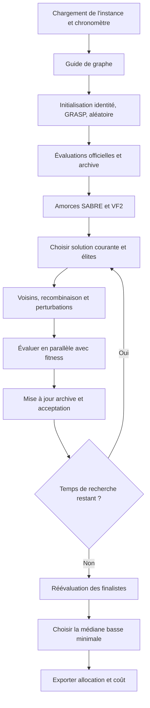

# Qubit Allocation Problem — Métaheuristique hybride V7

**Rapport technique et expérimental** · Version du 26 novembre 2026  
**Budget :** 300 secondes par instance · **Critère retenu :** médiane des coûts observés pour l'allocation finale.

## Résumé

 La V7 combine une construction gloutonne randomisée inspirée de GRASP, des amorces Qiskit (SABRE et VF2), une recherche locale guidée par les graphes, des perturbations de type VNS/ILS, une recombinaison de type *path relinking*, une acceptation inspirée du recuit simulé et une population élite diversifiée. Les évaluations de la fonction objectif officielle sont parallélisées.

Sur les neuf instances de référence, les médianes finales obtenues sont **20, 59, 115, 34, 315, 25, 22, 17 et 38**. Par rapport au meilleur score publié dans la présentation du professeur pour chaque instance, une référence est améliorée (instance 1 : 31 → 20, soit 35,48 % de réduction), quatre sont égalées et quatre ne sont pas atteintes. Les meilleurs coûts ponctuels donnent un bilan plus favorable, mais ne constituent pas nécessairement des coûts reproductibles des allocations exportées. Les neuf exécutions principales ont respecté le budget d'optimisation.

Ce rapport décrit la V7 actuelle, sans proposer de changement du critère final vers le minimum ponctuel. Les résultats réels proviennent des journaux d'exécution transmis par l'étudiant, et non d'une simulation ni de nouveaux tests réalisés pour ce rapport.

## Sommaire

1. [Formulation du problème](#1-formulation-du-problème)
2. [Fonction objectif et stabilité](#2-fonction-objectif-et-stabilité)
3. [Architecture de la V7](#3-architecture-de-la-v7)
4. [Principes théoriques et liens avec le cours](#4-principes-théoriques-et-liens-avec-le-cours)
5. [Implémentation et paramètres](#5-implémentation-et-paramètres)
6. [Résultats expérimentaux](#6-résultats-expérimentaux)
7. [Analyse critique et améliorations possibles](#7-analyse-critique-et-améliorations-possibles)
8. [Conclusion](#8-conclusion)
9. [Annexe — allocations et observations](#9-annexe--allocations-et-observations)
10. [Sources](#10-sources)

---

## 1. Formulation du problème

### 1.1. Permutation partielle

Soient $n$ le nombre de qubits logiques et $m$ le nombre de qubits physiques, avec $n\leq m$. Une allocation est un vecteur ordonné $\pi=(\pi_0,\ldots,\pi_{n-1})$, où $\pi_i$ désigne le qubit physique affecté au qubit logique $i$.

L'espace des solutions réalisables est :

$$
\Omega=\{\pi\in\{0,\ldots,m-1\}^n:\ \pi_i\neq\pi_j\ \text{si } i\neq j\}.
$$

Dans la formulation abstraite du sujet, on cherche $\min_{\pi\in\Omega} f(\pi)$. Deux permutations contenant les mêmes valeurs dans un ordre différent sont des solutions différentes. Par exemple, pour $n=3$ et $m=5$, `[0, 3, 1]` et `[1, 0, 3]` sont admissibles, contrairement à `[0, 3, 3]`.

Le nombre de solutions est :

$$
|\Omega|=A_m^n=\frac{m!}{(m-n)!}.
$$

| Instance | $n$ | $m$ | Nombre d'allocations possibles (approché) |
|---:|---:|---:|---:|
| 1 | 12 | 16 | $8,72\times10^{11}$ |
| 2 | 16 | 16 | $2,09\times10^{13}$ |
| 3 | 10 | 16 | $2,91\times10^{10}$ |
| 4 | 19 | 20 | $2,43\times10^{18}$ |
| 5 | 12 | 20 | $6,03\times10^{13}$ |
| 6 | 14 | 20 | $3,38\times10^{15}$ |
| 7 | 20 | 27 | $2,16\times10^{24}$ |
| 8 | 20 | 27 | $2,16\times10^{24}$ |
| 9 | 25 | 27 | $5,44\times10^{27}$ |

Une exploration exhaustive est donc impraticable dans les cinq minutes imposées. Cette situation correspond au cadre des méthodes approchées du cours : chercher une solution de bonne qualité dans un temps raisonnable, sans garantie générale d'optimalité [C1, p. 2–5 ; C4, p. 2–6].

### 1.2. Interprétation par les graphes

Le graphe physique représente les connexions autorisées entre les qubits de la machine. Le circuit fournit une suite d'interactions entre qubits logiques. Si deux qubits logiques qui doivent interagir sont éloignés dans le graphe physique, le routeur peut devoir insérer des opérations supplémentaires, notamment des SWAP.

Une bonne allocation initiale facilite le routage et peut réduire la profondeur finale. Toutefois, le problème n'est pas une simple association de graphes pondérés : les interactions ont un ordre temporel et les SWAP modifient les positions au cours de l'exécution. La présentation du projet insiste sur cette distinction [P, diapositives 2–9].

## 2. Fonction objectif et stabilité

### 2.1. Fonction officielle

Le fichier `source.py` charge le circuit et le backend, puis évalue une allocation à l'aide de Qiskit. Voici le passage essentiel (lignes 125–135) :

```python
qr = circuit.qregs[0]
init_mapping = {qr[i]: mapping[i] for i in range(len(mapping))}
init_mapping = Layout(init_mapping)
pm = generate_preset_pass_manager(3, backend, initial_layout=init_mapping)
pm.layout.remove(1)
pm.layout.remove(1)
QC = pm.run(circuit)
return QC.depth()
```

Le critère est la **profondeur du circuit transpilé**, c'est-à-dire le nombre de couches séquentielles sur son chemin critique selon Qiskit, et non le nombre total de portes ni le nombre de SWAP. La V7 conserve la fonction `fitness(mapping)` imposée, qui appelle `fitness_inner` sans modifier son calcul. Le projet exige Qiskit **1.2.4** [P, diapositive 10].

### 2.2. Pourquoi un même vecteur peut donner plusieurs coûts

Le pass manager ne reçoit aucun `seed_transpiler` dans `source.py`. La transpilation comprend des choix stochastiques ; une même allocation initiale peut donc aboutir à plusieurs circuits routés et à plusieurs profondeurs. Les journaux le confirment directement pour les instances 3, 4, 5, 7, 8 et 9.

On peut représenter ce phénomène par $F(\pi,\xi)$, où $\xi$ représente les choix aléatoires de la transpilation. Pour une allocation évaluée $k$ fois, on dispose des observations $c_1,\ldots,c_k$. La V7 utilise la médiane basse :

$$
\widehat f(\pi)=c_{(\lfloor(k+1)/2\rfloor)},
$$

où les $c_{(j)}$ sont triés dans l'ordre croissant, avec indices commençant à 1. Pour neuf observations, c'est la cinquième valeur triée. Pour un nombre pair, la médiane basse choisit la plus petite des deux valeurs centrales : le coût exporté est ainsi toujours un coût effectivement observé.

Ce choix vise un **faible coût typique**, et non la minimisation explicite de la variance ou du pire cas. Il constitue une décision méthodologique provisoire : les consignes demandent de minimiser `fitness`, mais ne précisent pas le protocole de traitement du bruit. La médiane n'est pas une nouvelle fonction imposée par le professeur.

### 2.3. Exemple réel : instance 3

L'allocation finale `[9, 6, 10, 5, 4, 12, 11, 2, 13, 3]` donne les observations suivantes :

```text
113 119 115 117 119 115 115 119 113
```

Après tri : `113 113 115 115 115 117 119 119 119`. La médiane vaut **115**, le minimum de ces neuf observations vaut **113** et le maximum vaut **119**. Pendant la recherche complète, le plus petit coût rencontré est **106**. Le journal ne permet pas d'identifier l'allocation ayant produit 106 ni d'établir que c'est celle finalement exportée. Il serait donc incorrect d'attribuer ce coût à l'allocation finale sans preuve.

Dans la suite, on distingue systématiquement :

- **Coût brut** : minimum de tous les appels à `fitness` effectués pendant l'exécution.
- **Coût retenu** : médiane basse des observations de l'allocation sélectionnée et écrite dans le fichier de résultat.
- **Stabilité empirique** : dispersion et fréquence des faibles coûts dans les observations disponibles. Neuf observations ne garantissent pas la répétabilité absolue.

## 3. Architecture de la V7

La V7 est une métaheuristique hybride à composante mémétique. Elle combine des mécanismes de trajectoire (recherche locale, perturbations, acceptation probabiliste) et de population (archive élite, recombinaison). Un seul processus pilote la recherche et répartit les tâches coûteuses entre des processus d'évaluation.



Le diagramme est volontairement synthétique : le code sauvegarde aussi le meilleur coût brut au fil des améliorations, avant de remplacer le fichier par la solution robuste finale. La génération des candidats et la sélection sont centralisées ; seules les tâches d'évaluation et les amorces Qiskit sont distribuées.

### Pseudocode de la recherche

```text
Initialiser l'archive A et le guide de graphe
Évaluer l'identité et les solutions construites ou aléatoires
Évaluer les allocations proposées par VF2/SABRE si disponibles
s ← meilleure allocation archivée

Tant que le budget d'exploration n'est pas épuisé :
    Construire une population élite diversifiée depuis A
    Si stagnation : perturber des élites et construire de nouvelles solutions
    Sinon : générer des voisins de s, recombiner des élites, perturber s
    Supprimer les doublons et compléter avec des solutions aléatoires
    Évaluer les candidats avec fitness en parallèle
    Enregistrer chaque observation et le meilleur coût brut
    Choisir le meilleur candidat du lot
    Accepter une amélioration ou parfois une détérioration
    Revenir périodiquement vers la meilleure allocation archivée

Présélectionner les meilleurs candidats selon la médiane basse
Réévaluer la présélection, puis les finalistes
Retenir le meilleur candidat confirmé selon la médiane basse
Écrire l'allocation et son coût dans le fichier
```

## 4. Principes théoriques et liens avec le cours

### 4.1. Voisinage et recherche locale

Le cours définit un voisinage $N(s)$ comme l'ensemble des solutions accessibles par un mouvement à partir de $s$ [C1, p. 15–26 ; C3, p. 3–14]. Une recherche de descente cherche des améliorations dans ce voisinage ; elle peut être bloquée dans un minimum local, qui n'est pas nécessairement global.

Dans `Guide.full`, le programme complète temporairement une permutation partielle par les qubits physiques non utilisés. Exemple : `[0, 3, 1]` devient `[0, 3, 1, 2, 4]`. Il échange ensuite des positions et ne conserve que les $n$ premières. Deux types de mouvements sont obtenus :

| Mouvement | Exemple à partir de `[0, 3, 1]` | Interprétation |
|---|---|---|
| Transposition logique-logique | `[3, 0, 1]` | Échanger deux affectations existantes |
| Transposition logique-libre | `[0, 4, 1]` | Affecter un qubit logique à une position physique libre |

Il existe $\binom{n}{2}+n(m-n)$ voisins élémentaires distincts. Pour l'instance 1, cela représente $66+48=114$ voisins ; pour l'instance 9, $300+50=350$. Le programme n'évalue pas tout le voisinage à chaque itération : il sélectionne un sous-ensemble, afin d'économiser les appels coûteux à `fitness`.

### 4.2. Guide de graphe : heuristique spécifique au problème

Le cours autorise l'utilisation d'heuristiques propres au problème dans une stratégie générique de niveau supérieur [C1, p. 5]. La V7 exploite la structure du circuit et du graphe physique pour ordonner les candidats.

1. Construire le graphe physique non orienté à partir de `backend.coupling_map`.
2. Calculer toutes les distances minimales avec Floyd–Warshall.
3. Extraire les interactions à deux qubits du circuit, hors barrières.
4. Construire trois matrices symétriques de poids temporels. Pour l'interaction d'indice $k$ parmi $L$ interactions, son poids est $\exp(-k/(L\tau))$, avec $\tau\in\{0.12,0.45,10\}$.

Les petites valeurs de $\tau$ privilégient fortement les interactions précoces ; la valeur 10 donne des poids presque uniformes. Pour chaque modèle, la fonction auxiliaire est :

$$
H_\tau(\pi)=\sum_{i<j}w_{ij}^{(\tau)}\max(0,d(\pi_i,\pi_j)-1).
$$

Une interaction entre qubits physiquement adjacents ne subit pas de pénalité. Une distance plus grande est pénalisée. La fonction ressemble à une formulation d'affectation quadratique, mais ne reproduit pas la profondeur après routage : elle ignore notamment les changements de positions au fil du circuit et le parallélisme réel des portes. Elle n'est pas une borne prouvée sur `fitness`.

Pour classer rapidement les échanges $(i,j)$, `Guide.deltas` calcule les variations de $H_\tau$ de manière vectorisée. Pour une permutation complétée (poids nuls pour les positions fictives), on obtient :

$$
\Delta H_{ij}=\sum_{\ell\notin\{i,j\}}(w_{i\ell}-w_{j\ell})
[d'(\pi_j,\pi_\ell)-d'(\pi_i,\pi_\ell)],
$$

où $d'(a,b)=\max(0,d(a,b)-1)$. Le terme relatif à la paire $(i,j)$ reste inchangé par l'échange car la distance est symétrique. Les voisins sont proposés en alternant les meilleures variations du proxy, les échanges entre positions physiquement adjacentes et des échanges aléatoires. Le guide ne remplace jamais l'évaluation officielle des candidats.

**Lien avec le cours :** les notions de voisinage, de coût incrémental et d'heuristique spécialisée sont transposées au placement de qubits ; l'utilisation de Floyd–Warshall et des pondérations temporelles est un choix d'implémentation propre à la V7, pas une prescription des supports de métaheuristiques.

### 4.3. GRASP : construction gloutonne randomisée

Le GRASP (*Greedy Randomized Adaptive Search Procedure*) présenté au cours combine une construction gloutonne randomisée et une amélioration par recherche locale [C2, p. 7–14 ; C3, p. 33–40 ; C4, p. 42]. La construction classique utilise une liste restreinte de candidats (RCL) :

$$
RCL=\{e:c(e)\leq c_{min}+\alpha(c_{max}-c_{min})\},\quad 0\leq\alpha\leq1.
$$

Une faible valeur de $\alpha$ favorise l'intensification ; une forte valeur favorise la diversification. Le candidat est tiré au hasard dans cette liste.

La fonction `Guide.grasp` est une **variante à RCL de taille variable**, et non l'application littérale de la formule du cours :

- Choisir au hasard l'un des trois modèles temporels.
- Prioriser les qubits logiques selon leur degré pondéré et leurs liens avec les qubits déjà placés ; tirer parmi les trois meilleurs disponibles.
- Calculer le coût incrémental de chaque position physique libre, avec un petit terme de centralité (coefficient 0,035) pour favoriser les emplacements accessibles.
- Tirer parmi les 1, 2 ou 3 meilleures positions, le nombre étant choisi aléatoirement.
- Répéter jusqu'à obtenir une allocation complète, puis effectuer au plus 24 échanges améliorant le proxy.

Cette descente interne accélère la production de solutions initiales prometteuses. La recherche principale les évalue ensuite avec `fitness`. Le GRASP classique du professeur, utilisé comme référence, n'est pas nécessairement identique à cette variante.

### 4.4. Recuit simulé : accepter une détérioration

Le recuit simulé permet d'échapper à un minimum local en acceptant parfois une solution moins bonne. Le cours présente la règle de Metropolis [C1, p. 29–38 ; C3, p. 18–21 ; C4, p. 8–12] : pour une détérioration $\Delta f>0$,

$$
P(\text{acceptation})=\exp(-\Delta f/T).
$$

Une température élevée favorise la diversification, tandis qu'une faible température privilégie l'intensification. La V7 reprend cette règle pour le meilleur candidat du lot. Sa température dépend du coût courant et du temps écoulé :

$$
T=\max(0.6,0.035\widehat f(s))(1-0.75r),
$$

où $r$ est la fraction de temps écoulée, bornée à 1. Le dénominateur utilisé dans l'exponentielle est au moins 0,15. Les égalités sont acceptées ; les améliorations strictes également. Contrairement au recuit standard enseigné, il n'y a ni paliers fixes ni refroidissement géométrique $T_{k+1}=\alpha T_k$ : il s'agit d'un mécanisme d'acceptation inspiré du recuit, intégré dans l'hybride.

### 4.5. VNS et ILS : changement de voisinage et perturbations

La recherche à voisinage variable (VNS) alterne secousse, recherche locale et changement de voisinage en cas d'échec [C2, p. 2–5 ; C3, p. 29–32 ; C4, p. 21–22]. L'ILS (*Iterated Local Search*, extension de la logique recherche locale + perturbation) consiste à repartir d'une solution modifiée pour explorer un autre bassin.

Dans `Guide.perturb`, plusieurs échanges sont appliqués successivement. La recherche normale utilise 2, 3 ou 4 échanges ; après cinq tours sans amélioration stricte (hors redémarrage), la V7 sélectionne une élite, crée des perturbations de 2 à 8 échanges au maximum et introduit aussi des solutions GRASP ou aléatoires. Le meilleur candidat du lot de redémarrage devient la nouvelle solution courante, même s'il est moins bon que l'ancienne.

Il s'agit d'une hybridation inspirée de VNS/ILS et non d'une VNS canonique avec parcours systématique de $N_1,\ldots,N_k$.

### 4.6. Population, élitisme et recombinaison mémétique

Les algorithmes évolutionnaires du cours utilisent une population, une sélection pour la reproduction, des croisements, des mutations et une sélection pour le remplacement [C2, p. 16–32 ; C4, p. 24–35]. Le cours montre également qu'un croisement ordinaire peut produire des permutations invalides [C4, p. 31–33]. L'approche mémétique ajoute une amélioration locale et maintient la diversité afin d'éviter la convergence vers des clones [C2, p. 30–31].

Dans la V7, `Search.elite` examine les 80 meilleures allocations de l'archive, puis retient au plus 12 individus suffisamment différents. La distance utilisée est la distance de Hamming :

$$
D_H(a,b)=\sum_{i=0}^{n-1}\mathbf 1[a_i\neq b_i].
$$

Deux élites retenues doivent différer sur au moins $\max(2,\lfloor n/5\rfloor)$ positions. Le choix des parents favorise les meilleurs individus tout en gardant accès aux autres élites.

Le croisement `Guide.crossover` est inspiré du *path relinking* : il part d'un parent $a$, puis choisit une fraction aléatoire des positions où $a$ et $b$ diffèrent (environ 25–75 %, avec au moins une si les parents diffèrent). Pour chaque position, la valeur désirée du parent $b$ est mise en place par échange dans la permutation complétée. Cela évite les doublons.

Exemple : `a = [0, 1, 2]`, `b = [2, 3, 1]`, $m=4$. Pour imposer `b[0] = 2`, on échange les positions 0 et 2 dans `[0, 1, 2, 3]`, ce qui donne `[2, 1, 0, 3]`, puis `[2, 1, 0]` comme enfant admissible.

La V7 n'est pas un algorithme génétique générationnel classique : elle possède une archive évolutive, une sélection élitiste et une recombinaison mêlées à la recherche locale. Elle est donc qualifiée d'**hybride à composante mémétique**, sans prétendre reproduire strictement l'algorithme du cours dans lequel la recherche locale remplace la mutation de chaque enfant. Ici, les perturbations restent présentes et chaque enfant n'est pas systématiquement soumis à une descente complète.

### 4.7. Mémoire des solutions et différence avec la recherche taboue

Le cours présente la recherche taboue comme une trajectoire qui interdit temporairement certains mouvements ou certaines solutions, avec une mémoire de longueur paramétrable [C1, p. 40–43 ; C3, p. 22–28 ; C4, p. 14–20].

La V7 utilise une archive `Search.data` qui associe chaque permutation au tableau de ses observations. Elle évite généralement les réévaluations et les doublons pendant l'exploration, sauf pour la validation explicite. Cette mémoire évite le gaspillage de temps et rappelle l'idée d'éviter de revenir sur ses pas, mais **ce n'est pas une recherche taboue classique** : il n'y a pas de liste FIFO de taille finie, de durée taboue ni de critère d'aspiration formel.

### 4.8. SABRE et VF2 : amorces propres au problème

En complément du GRASP, la V7 appelle au démarrage les passes `VF2Layout` et `SabreLayout` de Qiskit. VF2 tente de trouver une correspondance de sous-graphe ; SABRE propose une allocation initiale par une heuristique de routage et de placement. Ces passes produisent des vecteurs candidats, évalués ensuite par `fitness` comme tous les autres.

La V7 utilise une tentative VF2 (limite de 15 000 appels) et au moins trois tentatives SABRE avec graines variables, `max_iterations=3`, `layout_trials=4`, `swap_trials=4` et `skip_routing=True`. Si une amorce échoue, l'algorithme continue sans elle. Ces méthodes ne sont pas des chapitres des supports de cours : elles spécialisent la construction initiale au problème quantique.

### 4.9. Intensification et diversification : synthèse

Le compromis entre intensification et diversification est central dans les supports [C1, p. 11–14 ; C3, p. 8 ; C4, p. 6]. Une recherche trop intensive converge rapidement mais risque de stagner ; trop de diversification disperse le budget.

| Composant V7 | Intensification | Diversification |
|---|---|---|
| Construction GRASP | Choisir des positions à faible coût auxiliaire | Tirage dans la RCL et trois modèles temporels |
| Voisinage | Tester des échanges guidés par les distances | Tester aussi des échanges aléatoires |
| Population élite | Exploiter les meilleurs coûts | Imposer une distance de Hamming minimale |
| Croisement | Réutiliser des affectations prometteuses | Explorer une combinaison nouvelle |
| Recuit léger | Température réduite en fin de recherche | Accepter certaines détériorations |
| Perturbations et redémarrages | Repartir d'une élite | Modifier plusieurs affectations ou reconstruire |
| Mémoire | Réutiliser les observations | Éviter les évaluations répétées sans intérêt |
| Validation finale | Confirmer les meilleures allocations | N'est pas un opérateur de diversification |

Selon la classification de l'hybridation du cours [C2, p. 30–31, 44–45], l'intégration des opérateurs locaux dans la recherche à population relève surtout d'une hybridation de bas niveau ; la phase d'amorçage suivie de recherche illustre également une organisation en relais. Le partage d'une archive centrale ne fait pas des processus parallèles des îlots évolutionnaires indépendants.

## 5. Implémentation et paramètres

### 5.1. Organisation du code

Les numéros de lignes ci-dessous correspondent au fichier `livrable/StudentCode.py` disponible dans le projet (472 lignes). Le journal d'exécution désigne le fichier local de l'étudiant sous le nom `StudentCodeV7.py` ; son contenu exact n'a pas été fourni séparément. Les sorties observées sont cohérentes avec le code disponible, qui sert de base à cette explication.

| Fonction ou classe | Lignes | Rôle |
|---|---:|---|
| `fitness`, `instance_selector` | 8–25 | Interface imposée : chargement et fonction objectif |
| Paramètres | 48–58 | Groupe, budget, graine, mode, nombre de processus |
| `valide`, `tache` | 61–92 | Vérification et exécution d'une évaluation ou d'une amorce |
| `Guide.__init__`, `full`, `deltas` | 95–152 | Graphes, poids, permutation complétée et calcul des variations |
| `Guide.grasp` | 154–191 | Construction randomisée et descente sur le proxy |
| `Guide.perturb`, `crossover`, `voisins` | 193–244 | Opérateurs de recherche et recombinaison |
| `distance`, `Search.elite` | 247–248, 331–342 | Diversité de Hamming et sélection élitiste |
| `Search.save`, `record` | 267–281 | Archive, sauvegarde et suivi du meilleur coût brut |
| `Search.batch`, `evaluate` | 283–322 | Évaluation parallèle avec échéance et déduplication |
| `Search.score`, `rank` | 324–329 | Médiane basse et classement |
| `Search.run` | 344–449 | Initialisation, recherche, validation et export |
| `main` | 452–472 | Chronomètre, processus et arrêt |

### 5.2. Paramètres utilisés

| Paramètre | Valeur ou règle dans le code disponible | Justification |
|---|---|---|
| `QUBIT_BUDGET` | 300 s par défaut, plafonné à 300 | Limite demandée |
| `QUBIT_SEED` | 42 par défaut | Reproductibilité partielle de la recherche Python |
| `QUBIT_WORKERS` | Jusqu'à 4 par défaut, configurable de 1 à 8 | Exploiter plusieurs cœurs |
| `QUBIT_MODE` | `hybrid` par défaut | Algorithme complet ; `random` sert de témoin |
| `QUBIT_STRUCTURED` | Activé par défaut | Guide et amorces Qiskit ; désactivable pour une recherche boîte noire |
| Taille d'un lot | $\max(4,2\times\text{workers})$ ; 8 dans les essais | Paralléliser sans trop retarder la sélection |
| Élite | Au plus 12 parmi les 80 meilleurs | Qualité et diversité |
| Stagnation | 5 tours sans amélioration stricte | Déclencher un redémarrage |
| Retour au meilleur | Tous les 8 tours | Intensification périodique |
| Construction supplémentaire | Tous les 4 tours normaux | Diversification |
| Validation | 8 présélectionnés, puis 3 finalistes avec 4 processus | Réduire l'influence du bruit |
| Nombre d'observations visé | 9 pour chacun des 3 finalistes | Estimer un coût typique |

Les journaux confirment le mode hybride, quatre processus et un budget de 300 s. Ils ne donnent pas la graine effectivement utilisée ni toutes les variables d'environnement ; les autres valeurs du tableau correspondent donc aux réglages du fichier disponible, et non à une preuve indépendante de la configuration locale exacte.

### 5.3. Gestion des cinq minutes et parallélisation

`main` utilise `time.perf_counter()` et crée un pool de processus avec la méthode `spawn`, compatible avec Windows. La fonction `batch` envoie les tâches de manière asynchrone et cesse d'attendre lorsque l'échéance est atteinte. Les processus sont arrêtés et joints à la fin. Une marge de trois secondes est prévue pour leur fermeture.

La réserve de validation est ajustée selon le temps moyen des évaluations, avec des bornes ; pour un budget proche de 300 s, la réserve minimale est normalement d'environ 7,4 s. Les amorces Qiskit sont aussi soumises au chronomètre. Les temps du rapport sont des temps muraux d'optimisation, pas la somme des temps CPU des quatre processus. Le chargement initial du circuit et les imports sont effectués avant le chronomètre du processus principal. La marge ne constitue pas une garantie temps réel absolue pour toute machine ou tout blocage système.

### 5.4. Sélection finale et sauvegarde

La méthode `Search.score` retourne `statistics.median_low(self.data[p])`. Pendant l'exploration, presque chaque allocation n'a qu'une observation : sa médiane est alors simplement le premier coût obtenu.

À la fin, le code :

1. Retient les huit meilleurs candidats archivés dans la configuration à quatre processus.
2. Effectue deux tours de réévaluation de cette présélection, si le temps le permet.
3. Sélectionne les trois meilleurs après ces tours, puis cherche à compléter leurs observations jusqu'à neuf.
4. Choisit, dans la présélection, l'allocation confirmée (au moins trois observations) ayant la médiane basse minimale ; en cas d'égalité, il privilégie davantage d'observations puis le minimum le plus bas. À défaut de candidat confirmé, il utilise la présélection disponible.
5. Écrit l'allocation et son coût médian dans le fichier.

La sélection finale n'impose donc pas que tous les candidats comparés aient neuf observations. Dans les exécutions fournies, chaque allocation effectivement retenue possède bien neuf observations. La première observation de chaque candidat est utilisée à la fois pour la présélection et pour l'estimation finale : la validation réduit le biais de sélection, sans le supprimer complètement.

Le fichier contient une ligne avec les $n$ positions suivies du coût. Le code écrit d'abord dans un fichier temporaire puis effectue un remplacement atomique. Exemple réel pour l'instance 1 :

```text
1 15 2 13 3 12 8 11 0 4 5 14 20
```

Le nom est `GroupeXX_Instance_1.txt` pour l'instance 1 et `GroupeXX_Challenge_11.txt` pour une instance de challenge numérotée 11. Il faudra renseigner le véritable numéro de groupe. Le meilleur vecteur brut est mémorisé dans `self.best` au cours de la recherche, mais le fichier final ne le conserve pas séparément ; il est écrasé par le résultat médian. Les valeurs du rapport ne doivent pas être réinjectées dans l'algorithme.

### 5.5. Exécution et modes de comparaison

Avec le fichier source intact et Qiskit 1.2.4 dans l'environnement Python, modifier `instance_num` dans le fichier étudiant, puis lancer par exemple sous PowerShell :

```powershell
$env:QUBIT_GROUP = "GroupeXX"
$env:QUBIT_BUDGET = "300"
$env:QUBIT_WORKERS = "4"
$env:QUBIT_SEED = "42"
$env:QUBIT_MODE = "hybrid"
$env:QUBIT_STRUCTURED = "1"
.\.venv310\Scripts\python.exe StudentCodeV7.py
```

Le banc `Benchmark.py` disponible dans le projet lit `StudentCode.py` (et non `StudentCodeV7.py` par défaut). Pour l'utiliser sur la version actuelle, placer une copie identique de la V7 sous le nom attendu, avec `source.py` et `Instances/`. Il lance des exécutions isolées et conserve les journaux et le CSV. Exemple de comparaison future :

```powershell
.\.venv310\Scripts\python.exe Benchmark.py --instances 1 2 3 4 5 6 7 8 9 --budget 300 --seeds 42 43 44 --modes hybrid random blackbox
```

Cette commande représente 81 exécutions et n'a pas été exécutée pour ce rapport. Le mode `random` désactive le guide et les amorces, tandis que le mode `blackbox` conserve les mécanismes hybrides de recherche mais désactive les informations structurelles et les amorces. Le témoin aléatoire du code partage la validation finale, ce qui est utile pour une comparaison homogène.

---

## 6. Résultats expérimentaux

### 6.1. Protocole et données disponibles

- Fonction objectif : `fitness` officielle (selon les journaux et le code de base).
- Environnement indiqué : Windows PowerShell, environnement `.venv310` ; modèle CPU, version effective de Python et de Qiskit non documentés dans les journaux.
- Budget : 300 s ; quatre processus ; mode `hybrid`.
- Neuf instances distinctes, avec une répétition supplémentaire de l'instance 7.
- Pour le tableau principal, la **première exécution** de l'instance 7 est conservée, afin de ne pas favoriser cette instance en choisissant a posteriori le meilleur des deux essais. La seconde est présentée à part.
- Les références SABRE et GRASP sont celles de la dernière diapositive de la présentation du professeur [P, diapositive 14 / page PDF 15]. Il ne s'agit pas de nouvelles exécutions de ces méthodes sur le même ordinateur. Leur budget et leur protocole de réévaluation ne sont pas explicités sur cette diapositive.

### 6.2. Comparaison principale avec les références du professeur

La colonne « Réf. » contient $R_i=\min(SABRE_i,GRASP_i)$. L'écart relatif est calculé par $100(M_i-R_i)/R_i$, avec $M_i$ le coût médian retenu par la V7. Un écart négatif est favorable.

| Inst. | $n$ | $m$ | SABRE | GRASP | Réf. | V7 brut | V7 médian | Écart médian / réf. | Bilan médian |
|---:|---:|---:|---:|---:|---:|---:|---:|---:|---|
| 1 | 12 | 16 | 50 | 31 | 31 | 20 | **20** | **−35,48 %** | Améliorée |
| 2 | 16 | 16 | 59* | 59* | 59 | 59 | **59** | 0,00 % | Égalée |
| 3 | 10 | 16 | 108 | 113 | 108 | 106 | 115 | +6,48 % | En retrait |
| 4 | 19 | 20 | 35 | 30 | 30 | 29 | 34 | +13,33 % | En retrait |
| 5 | 12 | 20 | 323 | 308 | 308 | 314 | 315 | +2,27 % | En retrait |
| 6 | 14 | 20 | 25 | 25 | 25 | 25 | **25** | 0,00 % | Égalée |
| 7 | 20 | 27 | 22* | 22* | 22 | 22 | **22** | 0,00 % | Égalée |
| 8 | 20 | 27 | 17 | 17 | 17 | 17 | **17** | 0,00 % | Égalée |
| 9 | 25 | 27 | 51 | 36 | 36 | 38 | 38 | +5,56 % | En retrait |

\* Optimum exact annoncé dans la présentation du professeur ; la V7 ne démontre pas elle-même l'optimalité.

| Critère V7 | Références améliorées | Références égalées | Références non atteintes |
|---|---:|---:|---:|
| Coût médian retenu (critère principal) | **1** | **4** | **4** |
| Minimum brut de la recherche (indicateur secondaire) | 3 | 4 | 2 |

Par rapport à SABRE seul, les médianes sont meilleures dans quatre cas (1, 4, 5, 9), égales dans quatre (2, 6, 7, 8) et moins bonnes dans un (3). Par rapport à GRASP seul : une amélioration (1), quatre égalités (2, 6, 7, 8) et quatre dégradations (3, 4, 5, 9). Ces comparaisons sont descriptives ; l'absence de protocole commun empêche d'affirmer une supériorité statistique générale.

### 6.3. Stabilité des allocations retenues

| Inst. | Minimum des 9 | Médiane | Moyenne | Maximum | Étendue | Nb. au plus égales à la réf. |
|---:|---:|---:|---:|---:|---:|---:|
| 1 | 20 | 20 | 20,00 | 20 | 0 | 9/9 |
| 2 | 59 | 59 | 59,00 | 59 | 0 | 9/9 |
| 3 | 113 | 115 | 116,11 | 119 | 6 | 0/9 |
| 4 | 29 | 34 | 33,78 | 36 | 7 | 2/9 |
| 5 | 314 | 315 | 324,89 | 359 | 45 | 0/9 |
| 6 | 25 | 25 | 25,00 | 25 | 0 | 9/9 |
| 7 | 22 | 22 | 23,33 | 25 | 3 | 5/9 |
| 8 | 17 | 17 | 17,67 | 22 | 5 | 7/9 |
| 9 | 38 | 38 | 40,33 | 44 | 6 | 0/9 |

L'étendue est la différence entre le maximum et le minimum de l'échantillon. La dernière colonne compte les observations inférieures ou égales à la meilleure référence du professeur ; il ne s'agit pas de probabilités établies pour de futures évaluations.

Trois allocations (1, 2 et 6) donnent exactement le même coût lors des neuf observations. L'instance 5 illustre la résistance de la médiane aux valeurs extrêmes : les deux observations à 359 font monter la moyenne à 324,89, alors que la médiane reste à 315. Cependant, ce comportement peut être défavorable si le professeur juge une seule évaluation ou une moyenne. La médiane ne suffit donc pas à caractériser complètement la stabilité.

La deuxième exécution de l'instance 7 donne une autre allocation, une médiane de 22, sept observations à 22 et deux à 25 (moyenne 22,67). Cette répétition est encourageante, mais deux exécutions seulement ne permettent pas d'estimer solidement la variabilité entre exécutions.

### 6.4. Temps et nombre d'évaluations

| Inst. | Évaluations | Allocations distinctes | Temps total optimisation (s) | Évals/s | Dernière amélioration brute (s) |
|---:|---:|---:|---:|---:|---:|
| 1 | 19 317 | 19 283 | 290,47 | 66,5 | 125,9 |
| 2 | 3 593 | 3 559 | 294,69 | 12,2 | 1,9 |
| 3 | 10 105 | 10 071 | 291,50 | 34,7 | 78,7 |
| 4 | 25 257 | 25 223 | 290,01 | 87,1 | 181,4 |
| 5 | 9 261 | 9 227 | 290,89 | 31,8 | 17,1 |
| 6 | 21 788 | 21 754 | 290,06 | 75,1 | 1,3 |
| 7 | 17 215 | 17 181 | 289,99 | 59,4 | 1,6 |
| 8 | 15 311 | 15 277 | 290,15 | 52,8 | 109,1 |
| 9 | 16 025 | 15 991 | 290,12 | 55,2 | 24,1 |
| **Total** | **137 872** | **137 566** | **2 617,88** | — | — |

Le temps moyen d'optimisation est de 290,88 s, soit environ 4 min 51 s par instance. Les neuf exécutions principales totalisent 43 min 37,88 s. L'exécution supplémentaire de l'instance 7 dure 289,98 s et réalise 17 899 évaluations (17 865 allocations distinctes).

Les durées observées respectent toutes les cinq minutes pour la phase d'optimisation chronométrée. La différence de vitesse entre instances reflète notamment le coût de transpilation et les frais de recherche ; elle ne mesure pas à elle seule la difficulté combinatoire. Chaque exécution principale présente exactement 34 évaluations de plus que d'allocations distinctes : ce résultat est cohérent avec deux tours sur huit candidats (16 appels) puis six tours sur trois finalistes (18 appels). Il confirme que la réévaluation est principalement concentrée à la fin.

### 6.5. Convergence et interprétation par instance

| Inst. | Évolution des meilleurs coûts bruts (temps en secondes) | Lecture |
|---:|---|---|
| 1 | 57 (2,0) → 28 (2,1) → 21 (7,5) → 20 (125,9) | Amélioration majeure et coût final constant |
| 2 | 59 (1,9) | Optimum annoncé retrouvé dès le premier appel |
| 3 | 144 (2,0) → 113 (2,8) → 110 (39,2) → 106 (78,7) | Bon minimum ponctuel, mais médiane finale 115 |
| 4 | 62 (1,3) → 35 (1,9) → 30 (14,1) → 29 (181,4) | Amélioration tardive ; forte variabilité de la solution finale |
| 5 | 386 (1,4) → 323 (15,0) → 314 (17,1) | Long plateau ; médiane 315, référence 308 |
| 6 | 98 (1,3) → 25 (1,3) | Référence retrouvée rapidement et confirmée |
| 7 | 47 (1,4) → 22 (1,6) | Optimum annoncé atteint, mais pas à chaque évaluation |
| 8 | 30 (1,3) → 19 (2,9) → 18 (19,3) → 17 (109,1) | Référence atteinte après une recherche plus longue |
| 9 | 137 (1,3) → 51 (2,2) → 38 (24,1) | Nettement meilleur que SABRE, encore derrière GRASP |

Les instances 5 et 9 sont les plus révélatrices d'une stagnation prolongée sur des coûts supérieurs aux références : après leur dernière amélioration brute, il reste respectivement environ 274 s et 266 s sans nouveau minimum. Pour les instances 2 et 7, la stagnation du coût brut peut s'expliquer par l'atteinte de l'optimum annoncé ; cela ne signifie pas que toute amélioration de la stabilité serait impossible. Pour les autres instances, un plateau ne constitue ni une preuve de minimum local ni une preuve d'optimalité globale.

## 7. Analyse critique et améliorations possibles

### 7.1. Points forts

La méthode utilise des opérateurs qui conservent l'admissibilité, un guide rapide et une vraie fonction objectif inchangée. Elle exploite les notions d'intensification et de diversification du cours, avec une archive élite et un mécanisme de réévaluation. Le résultat de l'instance 1 est particulièrement convaincant au regard des données disponibles : coût 20 contre 31 pour la meilleure référence, et neuf observations à 20.

### 7.2. Limites de la V7

**Bruit pendant la recherche.** Presque toutes les allocations sont d'abord évaluées une seule fois. Un coût favorable dû au routage peut attirer la recherche vers une région peu prometteuse en termes de médiane. La validation intervient trop tard pour corriger entièrement cette orientation. Par ailleurs, les candidats initialement mal évalués peuvent être exclus alors qu'ils auraient une bonne médiane.

**Stagnation et coûts de gestion.** Les redémarrages et perturbations ne suffisent pas toujours à explorer des régions nouvelles. Le tri répété de toute l'archive et les lots synchronisés peuvent aussi consommer du temps ; leur coût relatif n'a pas été mesuré. Une analyse de profilage serait nécessaire avant de conclure qu'ils limitent effectivement le nombre d'évaluations.

**Respect du caractère boîte noire.** La présentation décrit une fonction objectif boîte noire [P, diapositive 2]. Le mode hybride exploite toutefois le circuit et le backend pour proposer des allocations. Il ne modifie pas `fitness`, mais n'est pas une méthode strictement boîte noire au sens « seuls $n$, $m$ et les appels à la fonction sont accessibles ». Il faut confirmer auprès de l'enseignant que le guide et les amorces Qiskit sont autorisés. Le mode `blackbox` constitue une alternative si cette restriction est imposée.

**Surapprentissage et généralisation.** Le code disponible ne contient ni allocations optimales préenregistrées, ni scores du professeur comme objectifs d'arrêt, ni paramètres propres aux neuf numéros d'instance. Les données structurelles sont calculées pour l'instance courante. Cela évite une forme de mémorisation, mais ne prouve pas l'absence de surajustement : les neuf instances sont désormais connues et toute nouvelle calibration fondée sur leurs résultats peut les favoriser. Les permutations de l'annexe sont uniquement des résultats expérimentaux.

**Comparabilité.** Les références de l'enseignant sont comparées aux médianes de la V7 sans savoir si elles ont été mesurées avec la même procédure de réévaluation et le même budget. Il faut éviter de présenter les différences comme une preuve d'amélioration générale ou comme de nouveaux records officiels validés par l'enseignant.

### 7.3. Pistes pour une future version (non implémentées ici)

La V7 reste la référence expérimentale et la sélection par médiane est conservée pour le moment. Les pistes suivantes peuvent être évaluées une par une :

| Piste | Objectif | Lien avec les notions du cours |
|---|---|---|
| Réévaluation progressive des candidats prometteurs (*racing*) | Réduire le biais des évaluations isolées ; mieux estimer la médiane pendant la recherche | Mémoire et exploitation de l'expérience ; extension au cas stochastique |
| Recherche taboue avec durée et aspiration | Explorer sans revenir immédiatement sur les mêmes mouvements | Recherche taboue [C1, p. 40–43 ; C4, p. 14–20] |
| Destruction/reconstruction d'une partie de la permutation (ALNS) | Explorer des voisinages plus larges en cas de plateau | Diversification et VNS [C2, p. 2–5] ; ALNS est une extension, pas la VNS du cours |
| Choix adaptatif des opérateurs | Consacrer plus d'effort aux opérateurs utiles à l'instance courante | Compromis intensification/diversification [C1, p. 11–14] |
| Amorces supplémentaires pendant les redémarrages | Explorer de nouveaux placements structurés | Multi-départs et hybridation |
| Archive brute distincte de l'archive robuste | Conserver les deux résultats sans changer le critère final | Mémoire, traçabilité expérimentale |

Ces pistes ne sont pas des performances démontrées. Il faut les comparer avec la V7, sans changer simultanément tous les mécanismes.

### 7.4. Protocole de validation recommandé

Pour un futur rapport plus rigoureux, fixer la configuration matérielle, la version de Qiskit et le budget, puis comparer V7, recherche aléatoire, mode boîte noire et variantes par ablation (sans GRASP, sans recombinaison, sans guide, etc.). Utiliser plusieurs graines Python communes entre méthodes, au minimum trois et idéalement davantage selon le temps disponible. Réévaluer toutes les allocations finales selon un protocole commun, en distinguant ce coût de vérification du budget de recherche ; si les cinq minutes doivent inclure toute vérification, réserver la même part de budget pour chaque méthode.

Rapporter la médiane et la dispersion entre exécutions, ainsi que le nombre d'évaluations et les temps. Une graine Python fixe ne suffit pas à rendre `fitness` déterministe. Conserver des instances nouvelles, non utilisées pour régler les paramètres, pour tester la généralisation. Ne pas modifier `source.py` pour fixer artificiellement la graine du routeur.

## 8. Conclusion

La V7 transpose plusieurs notions du cours à un problème de permutation partielle : construction gloutonne randomisée, recherche locale, voisinages variables, recuit simulé et hybridation mémétique. L'archive, le guide de graphe et la parallélisation permettent d'explorer un espace immense dans un budget limité.

Les expériences réelles montrent qu'une allocation peut produire plusieurs profondeurs après transpilation. Le choix provisoire d'une médiane basse permet de privilégier un coût faible typique. Sur les neuf instances, cinq médianes sont au moins aussi bonnes que les meilleures références du professeur, dont une amélioration importante sur l'instance 1. Les instances 3, 4, 5 et 9 restent prioritaires pour les études futures. Les minima bruts sont conservés dans le bilan comme information complémentaire, et non comme preuve de stabilité.

La suite logique consiste à améliorer l'utilisation du budget pendant les plateaux et la gestion du bruit durant la recherche, tout en conservant une version générique et en mesurant les gains de manière rigoureuse. Aucune preuve d'optimalité générale n'est apportée par la V7.

---

## 9. Annexe — allocations et observations

Les vecteurs suivants sont les allocations finales issues des journaux transmis. Les valeurs sont reproduites à titre documentaire et ne sont pas utilisées dans l'algorithme. Toutes sont des permutations partielles admissibles pour leurs dimensions.

| Inst. | Allocation finale | Coût médian |
|---:|---|---:|
| 1 | `[1, 15, 2, 13, 3, 12, 8, 11, 0, 4, 5, 14]` | 20 |
| 2 | `[0, 1, 2, 3, 4, 5, 6, 7, 8, 9, 10, 11, 12, 13, 14, 15]` | 59 |
| 3 | `[9, 6, 10, 5, 4, 12, 11, 2, 13, 3]` | 115 |
| 4 | `[7, 6, 11, 3, 12, 0, 13, 4, 5, 9, 1, 15, 14, 16, 8, 19, 2, 17, 10]` | 34 |
| 5 | `[8, 9, 0, 2, 11, 17, 7, 6, 18, 14, 12, 10]` | 315 |
| 6 | `[0, 10, 3, 6, 13, 14, 9, 12, 15, 11, 2, 7, 5, 4]` | 25 |
| 7 (essai 1) | `[0, 2, 3, 5, 8, 11, 12, 16, 19, 22, 21, 24, 25, 15, 23, 18, 13, 10, 4, 6]` | 22 |
| 7 (essai 2) | `[0, 2, 3, 5, 8, 11, 12, 16, 19, 22, 21, 24, 25, 15, 23, 18, 13, 7, 10, 6]` | 22 |
| 8 | `[12, 10, 13, 14, 2, 3, 22, 19, 21, 18, 15, 16, 11, 5, 8, 25, 23, 0, 4, 7]` | 17 |
| 9 | `[1, 20, 6, 15, 23, 12, 21, 25, 11, 24, 19, 26, 22, 9, 8, 3, 4, 5, 2, 10, 7, 17, 13, 14, 16]` | 38 |

| Inst. | Observations dans l'ordre fourni |
|---:|---|
| 1 | `20, 20, 20, 20, 20, 20, 20, 20, 20` |
| 2 | `59, 59, 59, 59, 59, 59, 59, 59, 59` |
| 3 | `113, 119, 115, 117, 119, 115, 115, 119, 113` |
| 4 | `29, 34, 34, 36, 34, 36, 36, 29, 36` |
| 5 | `314, 316, 315, 316, 315, 315, 359, 315, 359` |
| 6 | `25, 25, 25, 25, 25, 25, 25, 25, 25` |
| 7 (essai 1) | `22, 25, 22, 22, 25, 25, 22, 22, 25` |
| 7 (essai 2) | `22, 22, 22, 22, 22, 22, 22, 25, 25` |
| 8 | `17, 17, 17, 17, 17, 17, 17, 18, 22` |
| 9 | `38, 44, 38, 44, 38, 38, 44, 41, 38` |

## 10. Sources

### Documents du projet et supports de cours

Les renvois `p.` indiquent les pages PDF (numérotées à partir de 1). Pour la présentation du projet, le numéro de diapositive imprimé est décalé d'une page après la couverture.

- **[P]** J. Rouzé, `Présentation_Qubit_Allocation.pdf`, *Projet Graphes et Optimisation Combinatoire — Qubit allocation problem*, UMONS. Diapositives 2–9 : problème et graphes ; 10–13 : contraintes et rendu ; 14 : tableau SABRE/GRASP.
- **[C1]** `Partie1.pdf`, *Théorie des graphes et optimisation combinatoire — Métaheuristiques, partie 1*, UMONS, 2019–2020. Pages 2–7 : définition et classification ; 11–18 : intensification/diversification et voisinages ; 20–27 : recherche locale ; 29–38 : recuit ; 40–43 : tabou.
- **[C2]** `Partie2.pdf`, *Théorie des graphes et optimisation combinatoire — Métaheuristiques, partie 2*, UMONS, 2019–2020. Pages 2–5 : VNS ; 7–14 : GRASP ; 16–32 : algorithmes évolutionnaires et mémétiques ; 42–45 : efficacité et hybridation.
- **[C3]** M. Mezmaz et D. Tuyttens, `Métaheuristique.pdf`, *Métaheuristiques*, Service MATHRO. Pages 3–14 : paysage et recherche locale ; 18–21 : recuit ; 22–28 : tabou ; 29–32 : VNS ; 33–40 : GRASP.
- **[C4]** D. Tuyttens, `MMetDT.pdf`, *Optimisation combinatoire*, Service MATHRO. Pages 2–6 : classification et voisinage ; 8–12 : recuit ; 14–20 : tabou ; 21–22 : VNS ; 24–35 : évolution et croisements ; 42–44 : GRASP et choix de méthode.
- **[Code]** `source.py` et `livrable/StudentCode.py` : inspection directe du code disponible. `livrable/Benchmark.py` : banc d'essai disponible.
- **[Exp]** Journaux PowerShell des dix exécutions V7 transmis par l'étudiant, 26 novembre 2026. Calculs dérivés effectués à partir de ces valeurs ; pas de nouveaux essais Qiskit dans ce rapport.

### Inspirations scientifiques mentionnées dans le code

Ces références donnent le contexte de l'hybridation ; les explications techniques de ce rapport reposent sur le code et les supports du cours plutôt que sur une reproduction de leurs algorithmes.

- Rouzé et al., *A parallel memetic algorithm for qubit mapping on noisy intermediate-scale quantum machines* — DOI mentionné dans le code : [10.1016/j.engappai.2025.112081](https://doi.org/10.1016/j.engappai.2025.112081).
- G. Li, Y. Ding et Y. Xie, *Tackling the Qubit Mapping Problem for NISQ-Era Quantum Devices* (SABRE, 2019), [arXiv:1809.02573](https://arxiv.org/abs/1809.02573).
- Benlic et Hao (2013), travaux sur la recherche locale pour le problème d'affectation quadratique, mentionnés dans les commentaires de la V7.

Ces références externes sont des pistes bibliographiques reprises du contexte du développement ; elles n'ont pas fait l'objet d'une nouvelle vérification documentaire pour ce rapport.
