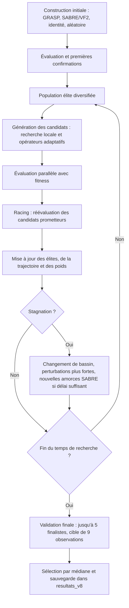
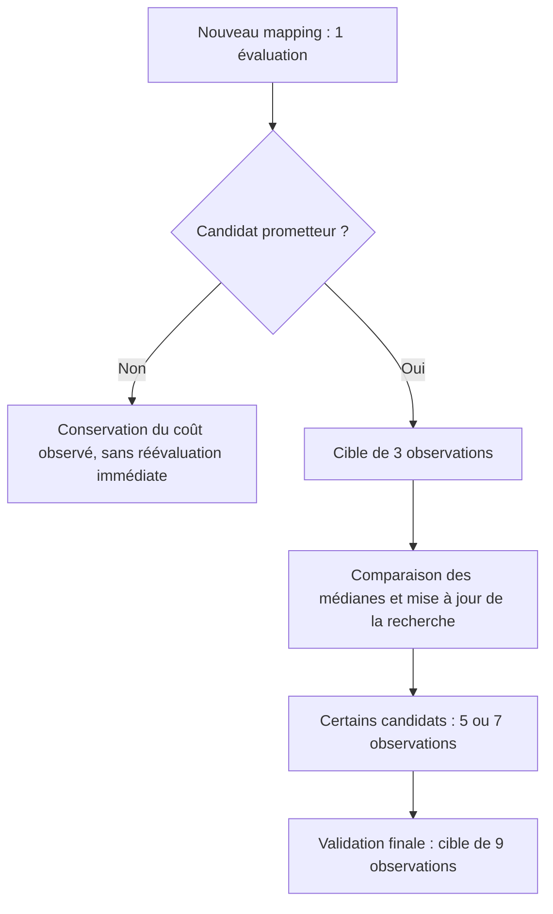

# V8 — Métaheuristique hybride adaptative

Cette version prolonge la [V7](DOCUMENTATION_V7.md). Les principes communs (GRASP, SABRE/VF2, recherche mémétique, recherche locale, recuit simulé, guide de graphe et parallélisation maître-travailleurs) sont expliqués dans la documentation V7 et ne sont pas redéveloppés ici.

## 1. Objectif de la V8

La V7 trouve rapidement de bonnes allocations, mais peut stagner longtemps. De plus, elle évalue généralement chaque mapping une seule fois pendant la recherche, ce qui peut favoriser des coûts obtenus par chance à cause du routage stochastique de Qiskit.

La V8 cherche à améliorer ces deux aspects en ajoutant trois mécanismes :

- **ALNS** : détruire puis reconstruire une partie du mapping pour explorer des voisinages plus larges ;
- **sélection adaptative des opérateurs** : favoriser les opérations qui donnent de bons résultats pendant l'exécution ;
- **racing** : réévaluer les candidats prometteurs dès la recherche, et pas uniquement à la fin.

La fonction `fitness` officielle, le critère final de médiane et le budget maximal de 300 secondes restent inchangés. `source.py` n'est pas modifié.

## 2. Fonctionnement général



Le processus principal conserve la maîtrise de la recherche. Les quatre workers évaluent toujours les mappings en parallèle, généralement par lots de huit candidats pour l'exploration. Le principe est identique à celui de la V7 (section 4.1 de sa documentation).

## 3. Nouveautés par rapport à la V7

### 3.1. ALNS — Destruction et reconstruction

Dans la V7, on modifiait principalement un mapping par des échanges, des réaffectations ou des perturbations. Dans la V8, la fonction `Guide.repair` retire plusieurs affectations puis les reconstruit en tenant compte des interactions entre qubits.

Exemple illustratif :

```text
Mapping initial  : [1, 5, 3, 8, 2, 6, 4, 7]
Destruction      : [1, ?, 3, 8, ?, 6, ?, 7]
Reconstruction   : [1, 4, 3, 8, 5, 6, 2, 7]
```

Deux opérateurs sont utilisés : `repair` retire des affectations aléatoires ; `related` retire des qubits liés à un qubit choisi. Lors de la reconstruction, le guide favorise les positions physiques proches des qubits déjà placés qui interagissent avec le qubit à réaffecter. Le choix est randomisé parmi les meilleures positions libres, ce qui évite les doublons et préserve la diversité.

En situation normale, la taille maximale de destruction est d'environ 30 % des qubits logiques ; elle passe à environ 55 % en cas de stagnation (avec un minimum de deux dans les instances du projet).

**Lien avec le cours :** la VNS alterne recherche dans un voisinage et secousses plus importantes pour sortir des minima locaux (`Partie2.pdf`, p. 2–5). La reconstruction randomisée reprend aussi l'idée de GRASP (p. 7–14). L'ALNS est ici une extension de ces principes, et non une méthode présentée sous ce nom dans ces pages.

### 3.2. Sélection adaptative des opérateurs

La V7 utilisait un enchaînement relativement fixe. La V8 attribue un poids à chacun de ses sept opérateurs :

| Opérateur | Rôle |
|---|---|
| `local` | Échanges et réaffectations guidés |
| `repair` | Destruction-reconstruction aléatoire |
| `related` | Destruction-reconstruction de qubits liés |
| `cross` | Recombinaison de bonnes allocations |
| `shake` | Perturbation de plusieurs positions |
| `grasp` | Construction d'un nouveau mapping |
| `random` | Nouvelle allocation aléatoire |

Les poids commencent à 1 et évoluent selon les résultats des candidats. Une amélioration confirmée reçoit davantage de crédit qu'une amélioration basée sur une seule observation. Le poids est lissé :

$$
w_{nouveau}=\max(0.20,\;0.88w_{ancien}+0.12\overline{r})
$$

où $\overline{r}$ est la récompense moyenne des propositions de l'opérateur lors du tour.

Le choix conserve une probabilité de 15 % de tirer un opérateur uniformément au hasard. Une partie du lot est toujours réservée à la recherche locale. En cas de stagnation, les opérateurs de reconstruction, de perturbation et GRASP sont davantage favorisés. La recherche peut changer de solution de départ parmi les élites et relancer SABRE à intervalles espacés.

**Lien avec le cours :** ce mécanisme adapte le compromis entre intensification et diversification pendant l'exécution (`Partie1.pdf`, p. 11–14). Il n'y a pas d'entraînement préalable sur les instances ni de poids spécifiques à leur numéro.

### 3.3. Racing — Gérer l'aléatoire de Qiskit

La V7 effectuait surtout les réévaluations en fin de recherche. La V8 utilise la fonction `Search.race` pour confirmer plus tôt les bonnes solutions.



Les candidats proches des meilleurs coûts (marge de 3,5 %, au minimum un point) sont prioritaires. Des confirmations périodiques complètent ce mécanisme. Après les 40 premiers appels, le racing en cours de recherche est soumis à un seuil de 28 % des évaluations déjà réalisées ; il s'agit d'un seuil de déclenchement et non d'une limite stricte, et la validation finale en est exclue.

Le classement privilégie la médiane basse, puis la moyenne, le maximum le plus faible et le nombre d'observations. La validation finale forme une présélection de 14 mappings au maximum et retient jusqu'à cinq finalistes. Si possible, la comparaison finale se fait entre les finalistes ayant au moins neuf observations ; sinon, elle utilise les candidats suffisamment réévalués ou les observations disponibles.

Le racing n'est pas une métaheuristique du cours à proprement parler : c'est un mécanisme complémentaire pour une fonction objectif stochastique. La médiane mesure la performance typique, mais ne garantit pas à elle seule une faible variabilité.

## 4. Modifications du code et exécution

| Élément | Changement |
|---|---|
| `Guide.repair` | Destruction et reconstruction guidées |
| `Search.choose_op`, `Search.propose` | Choix pondéré et génération des candidats |
| `Search.race` | Réévaluation sélective |
| `Search.record`, `Search.prune` | Mémorisation des observations et classement mis en cache ; archive active réduite périodiquement, historique complet conservé |
| `Search.run` | Gestion adaptative de la stagnation et nouvelle validation finale |
| `main`, `Search.batch` | Même principe de parallélisation que la V7 |

Paramètres par défaut : 300 secondes maximum, quatre workers si disponibles, graine de recherche 42, mode `hybrid`. Une réserve de validation et une marge de fermeture des processus sont prévues. La graine de recherche ne fixe pas le hasard interne de `fitness`.

Choisir `instance_num` dans `StudentCodeV8.py`, puis lancer :

```powershell
.\.venv310\Scripts\python.exe StudentCodeV8.py
```

Les résultats sont écrits dans `resultats_v8/` sans écraser ceux de la V7. Le terminal affiche également le meilleur coût brut et son mapping, le nombre de réévaluations et les propositions évaluées par opérateur. Le compteur par opérateur ne comprend pas toutes les amorces initiales.

## 5. Résultats expérimentaux

Une exécution par instance, sous Windows, quatre workers et 300 secondes autorisées. Les données V8 proviennent des journaux PowerShell transmis ; les données V7 sont celles des neuf exécutions principales de sa documentation. La médiane reste le critère principal.

| Instance | SABRE | GRASP (prof.) | Meilleure réf. | V7 médian | V8 brut | **V8 médian** | Écart V8/V7 | Temps V8 (s) |
|---:|---:|---:|---:|---:|---:|---:|---:|---:|
| 1 | 50 | 31 | 31 | 20 | 21 | **21** | +5,00 % | 281,13 |
| 2 | 59 | 59 | 59 | 59 | 59 | **59** | 0,00 % | 284,40 |
| 3 | 108 | 113 | 108 | 115 | 108 | **113** | −1,74 % | 282,03 |
| 4 | 35 | 30 | 30 | 34 | 29 | **29** | −14,71 % | 281,02 |
| 5 | 323 | 308 | 308 | 315 | 307 | **309** | −1,90 % | 281,20 |
| 6 | 25 | 25 | 25 | 25 | 25 | **25** | 0,00 % | 281,22 |
| 7 | 22 | 22 | 22 | 22 | 22 | **22** | 0,00 % | 281,17 |
| 8 | 17 | 17 | 17 | 17 | 18 | **18** | +5,88 % | 281,28 |
| 9 | 51 | 36 | 36 | 38 | 47 | **47** | +23,68 % | 281,38 |

Un écart négatif signifie une amélioration. La V8 améliore trois instances (3, 4, 5), en égale trois (2, 6, 7) et se dégrade sur trois (1, 8, 9). Par rapport aux meilleures références du professeur, elle en bat deux (1 et 4), en égale trois (2, 6, 7) et reste en retrait sur quatre (3, 5, 8, 9). Les instances 2 et 7 retrouvent les optima annoncés.

### Stabilité et capacité d'exploration

| Instance | Évaluations V7 | Évaluations V8 | Mappings distincts V8 | Réévaluations V8 | Min.–max. du mapping final V8 |
|---:|---:|---:|---:|---:|---:|
| 1 | 19 317 | 17 996 | 16 938 | 1 058 | 21–21 |
| 2 | 3 593 | 2 826 | 2 258 | 568 | 59–59 |
| 3 | 10 105 | 6 175 | 5 392 | 783 | 110–119 |
| 4 | 25 257 | 15 677 | 13 041 | 2 636 | 29–29 |
| 5 | 9 261 | 5 209 | 3 803 | 1 406 | 308–325 |
| 6 | 21 788 | 13 167 | 10 747 | 2 420 | 25–25 |
| 7 | 17 215 | 13 790 | 10 382 | 3 408 | 22–22 |
| 8 | 15 311 | 10 105 | 8 076 | 2 029 | 18–19 |
| 9 | 16 025 | 7 329 | 5 538 | 1 791 | 47–47 |
| **Total** | **137 872** | **92 274** | **76 175** | **16 099** | — |

- **Instance 4 :** la médiane passe de 34 à 29, contre 30 pour GRASP. Les neuf observations donnent 29 : le meilleur apport de la V8.
- **Instance 5 :** la médiane passe de 315 à 309, proche de la référence 308. Le minimum brut de 307 appartient à un autre mapping.
- **Instance 9 :** la médiane se dégrade de 38 à 47, malgré neuf observations identiques. Une solution stable n'est pas nécessairement une bonne solution.

Six mappings finaux donnent neuf coûts identiques, contre trois en V7. La V8 effectue cependant 33,1 % d'évaluations en moins et explore 44,6 % de mappings distincts en moins (76 175 contre 137 566). Les réévaluations représentent 17,4 % des appels V8, validation finale incluse. Le temps moyen est de 281,65 s contre 290,88 s pour la V7 ; toutes les exécutions respectent les 300 s d'optimisation, hors chargement initial.

### Mappings retenus

Les profondeurs suivantes correspondent aux médianes des mappings exportés, pas aux minima bruts de toute la recherche.

```text
Instance : 1 --- Meilleur mapping : [15, 0, 1, 13, 2, 12, 3, 11, 4, 6, 5, 14] --- Profondeur finale : 21
Instance : 2 --- Meilleur mapping : [0, 1, 2, 3, 4, 5, 6, 7, 8, 9, 10, 11, 12, 13, 14, 15] --- Profondeur finale : 59
Instance : 3 --- Meilleur mapping : [8, 7, 10, 5, 13, 11, 1, 4, 12, 3] --- Profondeur finale : 113
Instance : 4 --- Meilleur mapping : [7, 6, 9, 12, 13, 1, 8, 5, 3, 0, 11, 18, 4, 16, 10, 14, 2, 19, 15] --- Profondeur finale : 29
Instance : 5 --- Meilleur mapping : [17, 16, 5, 7, 8, 4, 14, 1, 0, 11, 6, 10] --- Profondeur finale : 309
Instance : 6 --- Meilleur mapping : [1, 10, 2, 3, 18, 13, 7, 19, 15, 11, 12, 0, 5, 8] --- Profondeur finale : 25
Instance : 7 --- Meilleur mapping : [1, 2, 3, 5, 8, 11, 14, 16, 19, 22, 25, 24, 23, 21, 18, 15, 12, 10, 4, 6] --- Profondeur finale : 22
Instance : 8 --- Meilleur mapping : [8, 5, 15, 18, 0, 4, 19, 22, 14, 11, 13, 25, 12, 10, 7, 16, 9, 2, 3, 1] --- Profondeur finale : 18
Instance : 9 --- Meilleur mapping : [19, 17, 23, 14, 20, 18, 15, 24, 26, 22, 25, 21, 4, 2, 1, 7, 10, 3, 5, 9, 8, 11, 16, 13, 12] --- Profondeur finale : 47
```

## 6. Bilan et perspectives

La V8 améliore la confirmation des bonnes solutions et obtient un résultat particulièrement convaincant sur l'instance 4. En revanche, elle n'est pas globalement supérieure à la V7 sur ces essais. La réduction du nombre de candidats explorés est importante ; le racing n'en explique qu'une partie. La génération ALNS, les tris, la synchronisation des workers et la réserve de validation sont des pistes à mesurer, pas des causes établies.

Pour la V9, il serait intéressant de conserver le racing mais de le rendre plus sélectif, de réserver davantage l'ALNS aux situations de stagnation, de retrouver le débit d'exploration de la V7 et de mieux exploiter le temps de validation restant. Par exemple, sur les instances 3 et 5, les meilleures médianes provisoires (110 et 308) ne sont pas les médianes finales (113 et 309) : une confirmation sur trois ou cinq observations peut changer avec de nouveaux appels. Les médianes provisoires sont donc des diagnostics, pas des résultats finaux.

L'équilibre entre intensification et diversification reste le principe central de l'hybridation. Aucun mapping ni score de référence n'est intégré à la recherche. Les règles restent génériques, mais une seule exécution V8 par instance ne suffit pas pour isoler l'effet de chaque nouveauté ou démontrer une meilleure généralisation. Il faudrait comparer plusieurs graines et, idéalement, des instances inédites. Le protocole de vérification des références du professeur reste inconnu.

## Références

- [DOCUMENTATION_V7.md](DOCUMENTATION_V7.md) : principes communs, schéma de parallélisation et résultats V7.
- `StudentCodeV8.py` et `StudentCodeV7.py` : comparaison des implémentations.
- `Partie1.pdf`, UMONS, p. 11–14 : intensification et diversification.
- `Partie2.pdf`, UMONS, p. 2–5 : VNS ; p. 7–14 : GRASP ; p. 30–31 : algorithmes mémétiques et hybridation.
- `Présentation_Qubit_Allocation.pdf`, J. Rouzé, UMONS, p. 15 : références SABRE et GRASP.
- Journaux PowerShell V8 transmis par l'utilisateur (`Texte collé.txt`). Aucun nouvel essai Qiskit n'a été effectué pour cette documentation.
