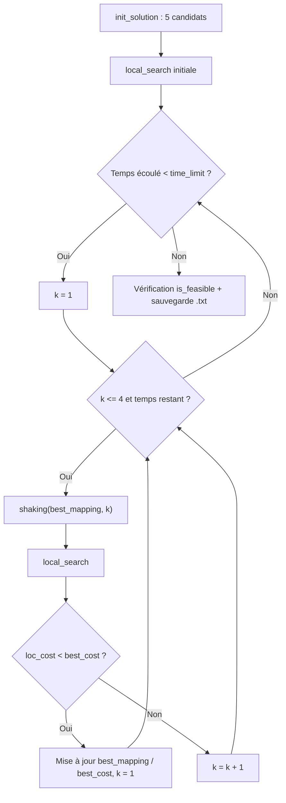

# Documentation — `StudentCode.py`

## 1. Objectif du programme

Ce script résout le problème de **placement initial de qubits** (*qubit mapping*) pour un circuit quantique :
- **Entrées** : un circuit quantique à $n$ qubits logiques et une architecture cible (`backend`) à $m$ qubits physiques ($n \le m$).
- **Décision** : trouver une liste `mapping` de longueur $n$ telle que le qubit logique $i$ soit placé sur le qubit physique `mapping[i]`, sans doublon.
- **Objectif** : **minimiser la profondeur** (`depth`) du circuit après transpilation par Qiskit (`fitness`).

---

## 2. Paramètres principaux

Dans [StudentCode.py](StudentCode.py#L23-L35) :

| Variable | Rôle | Valeur actuelle |
| :--- | :--- | :--- |
| `instance_num` | Numéro de l'instance à charger (`1` à `9`) | `1` |
| `numero_du_groupe` | Numéro utilisé dans le nom du fichier de sortie | `1` |
| `time_limit` | Temps maximal d'exécution de la recherche (en secondes) | `30.0` |

> [!NOTE]
> `instance_selector(instance_num)` (défini dans [source.py](source.py#L104-L123)) charge le `backend`, le `circuit`, `n` et `m`. La fonction `fitness(mapping)` appelle `fitness_inner(mapping, circuit, backend)` qui exécute le transpiler Qiskit (niveau d'optimisation `3`) et renvoie la profondeur du circuit résultant.

---

## 3. Fonctionnement de l'algorithme (VNS)

### Résumé de la méthode

La **VNS** (*Variable Neighborhood Search*, ou recherche à voisinage variable) est une métaheuristique qui cherche à éviter de rester bloquée dans un optimum local. À partir d'une solution initiale améliorée par recherche locale, l'algorithme alterne deux phases : une **perturbation** (*shaking*) de plus en plus forte (voisinages $N_1$ à $N_4$) pour explorer d'autres zones de l'espace de recherche, suivie d'une **recherche locale** pour atteindre le meilleur voisinage autour de ce nouveau point. Dès qu'une meilleure solution globale est trouvée, la recherche reprend depuis le plus petit voisinage ($k = 1$), jusqu'à ce que la limite de temps (`30.0` s) soit atteinte.



---

## 4. Description des fonctions

| Fonction | Lignes | Rôle |
| :--- | :--- | :--- |
| `is_feasible(mapping, n, m)` | [L38-L43](StudentCode.py#L38-L43) | Vérifie que `mapping` contient exactement `n` qubits physiques distincts dans l'intervalle `[0, m - 1]`. |
| `evaluate(mapping, cache)` | [L46-L50](StudentCode.py#L46-L50) | Retourne `fitness(mapping)` en utilisant un dictionnaire `cache` (clé `tuple(mapping)`) pour éviter de ré-évaluer un mapping déjà connu. |
| `swap_move(mapping)` | [L53-L58](StudentCode.py#L53-L58) | Échange les qubits physiques attribués à 2 qubits logiques tirés aléatoirement. |
| `replace_move(mapping, m)` | [L61-L70](StudentCode.py#L61-L70) | Si $n < m$, remplace le qubit physique d'un qubit logique aléatoire par un qubit physique libre ; sinon applique `swap_move`. |
| `init_solution(n, m, cache, nb_starts=5)` | [L73-L85](StudentCode.py#L73-L85) | Évalue `list(range(n))` ainsi que `nb_starts - 1` mappings aléatoires, et renvoie le meilleur. |
| `local_search(..., max_evals=25)` | [L88-L130](StudentCode.py#L88-L130) | Descente locale en *first-improvement* : génère tous les voisins (`swap` et `replace`), les mélange, et teste jusqu'à `max_evals` voisins. Dès qu'une amélioration est trouvée, elle est adoptée et la recherche repart de ce nouvel état. |
| `shaking(mapping, k, m)` | [L133-L154](StudentCode.py#L133-L154) | Perturbe `mapping` dans le voisinage $N_k$ avec `1` opération (`k=1`), `2` (`k=2`), `max(3, n // 4)` (`k=3`) ou `max(4, n // 2)` (`k=4`), en mélangeant `replace_move` (40 % si $m > n$) et `swap_move`. |
| `vns(n, m, time_limit=30.0)` | [L157-L183](StudentCode.py#L157-L183) | Boucle principale de la VNS : alterne `shaking` ($k = 1 \dots 4$) et `local_search` jusqu'à atteindre `time_limit`, et renvoie `(best_mapping, best_cost)`. |

---

## 5. Justifications des choix de la VNS

- **Choix de la VNS** : l'espace de recherche contient $\frac{m!}{(m-n)!}$ mappings possibles avec une fonction `fitness()` coûteuse. La VNS permet d'échapper aux optima locaux mieux qu'une simple recherche locale tout en restant adaptée au budget de 30 s.
- **Voisinages (`swap_move` et `replace_move`)** : `swap_move` permute deux qubits logiques déjà placés, tandis que `replace_move` exploite les qubits physiques libres lorsque $n < m$ pour explorer d'autres emplacements du `backend`.
- **Niveaux de perturbation $N_k$ et `k_max = 4` dans `shaking`** : 4 niveaux progressifs (1 mouvement, 2 mouvements, ~25 %, ~50 %) équilibrent l'intensification autour de la meilleure solution et la diversification, sans multiplier inutilement les niveaux ni détruire complètement le mapping.
- **Règle de changement de voisinage (`k = 1` ou `k += 1`)** : dès qu'une meilleure solution est trouvée, la recherche revient au plus petit voisinage ($k = 1$) pour exploiter la nouvelle zone, et n'augmente $k$ qu'en cas d'échec.

---

## 6. Exécution et fichier de sortie

### Lancer le script
Depuis la racine du projet (avec `qiskit` installé dans l'environnement Python actif) :

```bash
python StudentCode.py
```

*(Si vos fichiers `.qasm` sont placés dans un sous-dossier `Instances/Instances/`, lancez depuis `Instances/` avec `python ../StudentCode.py`.)*

### Sortie générée
1. Affichage console : numéro d'instance, `n`, `m`, meilleure profondeur et `best_mapping`.
2. Fichier texte `Groupe<numero_du_groupe>_Instance_<instance_num>.txt` contenant sur une ligne les $n$ indices du mapping séparés par des espaces, suivis de `best_cost` :
   ```text
   q0 q1 ... q_{n-1} best_cost
   ```
